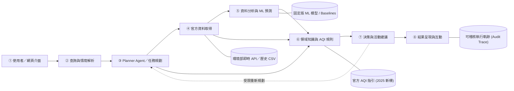

# AirGuard AI — 智慧空氣品質預測與生活決策代理人

> **課程名稱**：物聯網數據分析與應用（AIoT-DA）  
> **專案性質**：三人團體期末專題 × IEEE ICEIB 學術論文規劃  
> **目前階段**：提案與系統設計、OpenSpec 規格規劃與 IEEE ICEIB 論文撰寫準備階段  
> **GitHub 儲存庫**：<https://github.com/kelp11211/DIC4>  
> **組員名單**：組長：林宏陽（7115056179）｜組員：蔡明憲（7115056013）、許鈵昆（8114056002）

---

## 專案簡介 (Overview)

**AirGuard AI** 是一個專為戶外運動愛好者與敏感族群設計的 **Domain AI Agent**。本專案不只做單純的模型預測，也不做無約束的通用對話聊天機器人，而是設計一個**「懂領域知識、能自動取得官方資料、會嚴謹分析與回測、具白名單工具推理，並能提供客觀證據與安全邊界」**的決策代理人系統。

本系統以**臺灣環境部（MOENV）**官方即時與歷史監測資料為核心基礎，結合 1、3、6 小時 PM2.5 短期時間序列機器學習預測，並導入 2025 年最新修訂門檻的 AQI 官方活動指引，提供具備資料時間戳、誤差帶與官方指引依據的可解釋決策卡片。

> [!IMPORTANT]
> **學術誠實原則聲明（Academic Honesty Declaration）**  
> 本專案目前處於 **Proposal 提案與系統架構設計階段**。所有列出之模型成效、回測數據與系統功能均為**「預期成果（Expected Outcomes）」**，尚未進行實際訓練與回測驗證。本團隊嚴格遵守學術誠實原則，絕不宣稱未經回測的準確率或健康保證。

---

## 核心安全防線與設計邊界 (Core Boundaries)

為防範大型語言模型（LLM）常見之幻覺（Hallucination）與醫療越權診斷風險，本專案確立四大設計防線：

1. **測站尺度 ≠ 街道個人暴露**：測站觀測值僅代表固定測站周邊巨觀空氣品質，絕不宣稱可替代任意街道或個人的精準暴露劑量。
2. **PM2.5 預測 ≠ 官方 AQI 預報**：機器學習預測之 1/3/6h PM2.5 數值僅供趨勢參考，嚴格區隔於官方發布之 AQI，不自行計算或冒充「官方空品預報」。
3. **時距外推限制**：嚴禁以 1/3/6 小時模型任意向外推論隔日全天或長期趨勢；超出時距時主動觸發安全降級。
4. **非醫療診斷**：所有建議均依據官方公開之活動指引，不提供任何個人醫療診斷、治療指示或健康結果保證。

---

## 系統八大模組架構 (System Architecture)

系統完全遵循正式提案與 [`myplan/DESIGN.md`](myplan/DESIGN.md) 規劃之八個編號模組（①–⑧）：



### 模組功能對照表

| 編號 | 模組名稱 | 功能職責 | 預定實作路徑 |
| :--- | :--- | :--- | :--- |
| **①** | **使用者／網頁介面** | 運動情境輸入、測站／族群選擇、視覺化圖表與建議卡片呈現 | `app/` (Next.js) |
| **②** | **查詢與情境解析** | 提取意圖、時間窗口、測站地點、活動強度與一般／敏感族群標記 | `src/airguard/query.py` |
| **③** | **Planner Agent** | 白名單工具（Allowlist Tools）調度、執行計畫生成、安全降級控制 | `src/airguard/agent.py` |
| **④** | **官方資料取得** | 環境部 API / CSV 自動取得、資料新鮮度查核與品質驗證（ETL） | `src/airguard/data/` |
| **⑤** | **資料分析與 ML 預測** | 防時序洩漏之 1/3/6h PM2.5 預測、基線比較（Persistence / Seasonal Naive） | `src/airguard/ml/` |
| **⑥** | **領域知識與 AQI 規則** | 2025 最新 AQI 分級門檻、六大污染物副指標、一般與敏感族群活動指引 | `src/airguard/domain/` |
| **⑦** | **決策與活動建議** | 候選運動時段比較、誤差帶交叉比對、保守安全原則約束 | `src/airguard/decision.py` |
| **⑧** | **結果呈現與互動** | 整合官方觀測卡、預測趨勢卡、活動指引卡與完整資料來源追溯（Provenance） | `src/airguard/report.py` |

---

## 官方資料來源 (Data Sources)

| 資料集代碼 | 資料集名稱 | 用途與說明 |
| :--- | :--- | :--- |
| **`AQX_P_432`** | 環境部每小時空氣品質指標 (AQI) | 取得正式公布之即時/近期測站 AQI 與主污染物數據 |
| **`AQX_P_488`** | 環境部歷史空氣品質指標 (AQI) | 歷史回測驗證輔助、季節趨勢查核 |
| **`AQX_P_13`** | 環境部空氣品質監測小時值 (PM2.5) | 1/3/6h 時間序列特徵工程與模型訓練主要輸入 |
| **`MOENV_AQI_GUIDE`** | 環境部 AQI 官方活動指引 | 採用 2025 年 1 月 1 日起實施之最新 AQI 分級與活動建議規範 |

---

## 雙軌評估規劃 (Evaluation Plan)

本專案規劃嚴謹的雙軌驗證機制（Track A 與 Track B）：

### Track A: 時間序列預測評估 (PM2.5 Forecast)
- **資料集**：以臺中市代表性測站（如忠明、西屯等）2024–2026 年觀測資料為基礎。
- **嚴防時間洩漏**：採嚴格時間先後順序切分（70% Train / 15% Val / 15% Test），配合 Rolling-origin 交叉驗證。
- **基線模型（Baselines）**：
  - *Persistence*：$\hat{y}(t+h) = y(t)$
  - *Seasonal Naive*：$\hat{y}(t+h) = y(t+h-24h)$
- **候選模型**：Ridge Regression、Random Forest、XGBoost（延伸比較 LSTM）。
- **評估指標**：MAE（平均絕對誤差）、RMSE、相對改善增益（$\text{Skill\_MAE} = 1 - \frac{\text{MAE}_{\text{model}}}{\text{MAE}_{\text{persistence}}}$）。

### Track B: Domain AI Agent 決策評估 (Agent & Decision)
- **情境測試集**：建立至少 30 個標準化測試情境（涵蓋一般／敏感族群、地理歧義、API 延遲、缺值異常、超時距外推請求等）。
- **驗收指標**：
  - 工具選擇正確率（Tool Selection Accuracy）
  - 官方指引一致率（Guidance Consistency）
  - 來源與時間標註完整率（Provenance Completeness）
  - 安全降級達成率（Graceful Degradation Rate）
  - 系統響應延遲（Response Latency）

---

## 六週實作交付路線圖 (Roadmap)

```text
W1 (資料盤點)  ──▶  W2 (模型基線)  ──▶  W3 (Agent 核心)  ──▶  W4 (Web 整合)  ──▶  W5 (雙軌實驗)  ──▶  W6 (期末交付)
 盤點 API/CSV       建立 Persistence     實作 Tool Allowlist    打造 UI 互動介面     執行分站/時距回測    彙整 Final PPT
 凍結測站與期間     訓練 Ridge/RF/XGB    結合官方 2025 指引     串接 API/Agent       30 個 Agent 測試集   展示影片與結案
```

---

## IEEE ICEIB 研討會論文規劃 (`ICEIB paper/`)

本專案同步籌備投稿 **[IEEE ICEIB](https://www.iceib.asia/)**（*IEEE International Conference on Electronic Communications, Internet of Things and Big Data*）之英文研討會論文，採用標準 `IEEEtran` 雙欄會議格式（`\documentclass[conference,a4paper]{IEEEtran}`），並依循 [`myplan/A2Z outline example.pdf`](myplan/A2Z%20outline%20example.pdf) 之 **2020 A–Z 科研論文 SOP** 與 [`myplan/空品決策代理人.md`](myplan/%E7%A9%BA%E5%93%81%E6%B1%BA%E7%AD%96%E4%BB%A3%E7%90%86%E4%BA%BA.md) 進行結構化撰寫：

| 對應 OpenSpec 變更 | 目標分段檔案 | 論文區段 | A–Z SOP 涵蓋範圍 |
| :--- | :--- | :--- | :--- |
| `000-abstract` | `ICEIB paper/000-Abstract.txt`（及 `main.txt` 組裝檔頭） | **Abstract** | `A–F`（Attention, But, Cure, Development, Experiments, Expected Findings） |
| `001-introduction` | `ICEIB paper/001-Introduction.txt` | **I. Introduction** | `G–L`（General, However, In literature, Judgement/SWOT, Keypoints, List org） |
| `002-related-work` | `ICEIB paper/002-Related Work.txt` | **II. Related Work** | `M–O`（AI 50% + Domain 50%、8 欄文獻表、4×5 SWOT 與 Research Gap） |
| `003-proposed-design` | `ICEIB paper/003-Proposed Design.txt` | **III. Proposed Design** | `PA–PM`（八大模組 ①–⑧、架構圖與流程圖、Algorithm 1/2、走查與形式化） |
| `004-experiment` | `ICEIB paper/004-Experiment.txt` | **IV. Experiment** | `Q–V`（Track A 時序回測指標／基線／消融、Track B ≥30 安全情境驗證） |
| `005-conclusion` | `ICEIB paper/005-Conclusion.txt` | **V. Conclusion** | `W–Z`（回顧、優勢場景、預期產出、W1–W6 路線、四大限制與風險矩陣） |
| `006-reference` | `ICEIB paper/006-Reference.txt`（及 `main.txt` 總裝驗證） | **References** | IEEE `\bibitem` 書目溯源與跨檔 LaTeX 結構檢查 |

> [!NOTE]
> 目前 [`ICEIB paper/main.txt`](ICEIB%20paper/main.txt) 已完成整體初稿；上述 `000-abstract` 至 `006-reference` 已建立完整 OpenSpec 規格，待執行 `/opsx-apply` 進行模組化拆分與 A2Z 細部對齊。

---

## 專案結構 (Repository Structure)

```text
DIC4/
├── ICEIB paper/                                        # IEEE ICEIB 研討會論文撰寫區
│   └── main.txt                                        # IEEEtran 雙欄會議論文初稿（可更名為 main.tex 編譯）
├── .agents/                                            # OpenSpec 與 Antigravity AI 輔助工作流程配置
│   ├── skills/                                         # openspec-propose, apply, update, sync, archive, explore 等技能
│   └── workflows/                                      # 規格驅動開發指令與引導流程（opsx-*.md）
├── myplan/                                             # 期末專案提案規劃、科研 SOP 與佐證資料
│   ├── DESIGN.md                                       # AirGuard AI 完整系統架構與實作設計規格書
│   ├── A2Z outline example.pdf                         # 2020 A-Z 科研論文寫作 SOP 原始範例
│   ├── AirGuard AI 完整 A2Z 科研提案資訊圖表.png         # A2Z 26 步驟系統性解析資訊圖表
│   ├── AirGuard_AI_Final_Proposal.docx                 # 期末專題正式提案報告書
│   ├── AirGuard_AI_infographic_conversation_2026-11-11.md # 資訊圖表編修與 A2Z 對齊紀錄
│   ├── INTRODUCTION_REFACTOR.md                        # 緒論（G–L）重構與實證資料對齊稿
│   ├── RELATED_WORK_REFACTOR.md                        # 相關研究（M–O）與 8 欄文獻表重構稿
│   ├── 空品決策代理人.md                                # 提案報告與簡報之 A2Z 深度解析文件
│   ├── 空污 × 戶外運動 AI Agent 提案：研究佐證資料.md    # 2024–2026 公衛、運動醫學與 AI 安全佐證彙整
│   └── 空污 × 戶外運動 AI Agent：預期貢獻與學術價值.md    # 預期貢獻、創新比較與研究限制說明
├── openspec/                                           # OpenSpec 規格驅動開發資料庫
│   ├── config.yaml                                     # OpenSpec 設定檔（schema: spec-driven, 語言: zh-TW）
│   ├── changes/                                        # 進行中與已歸檔之變更提案
│   │   ├── init-airguard-foundation/                   # 系統基礎工程、核心契約、資料擷取與 2025 AQI 規則（0/13 tasks）
│   │   ├── 000-abstract/                               # ICEIB 論文 000 摘要與主控檔組裝規格（4/4 planning）
│   │   ├── 001-introduction/                           # ICEIB 論文 001 緒論（G–L）規格（4/4 planning）
│   │   ├── 002-related-work/                           # ICEIB 論文 002 相關研究（M–O）規格（4/4 planning）
│   │   ├── 003-proposed-design/                        # ICEIB 論文 003 系統設計（PA–PM）規格（4/4 planning）
│   │   ├── 004-experiment/                             # ICEIB 論文 004 實驗設計（Q–V）規格（4/4 planning）
│   │   ├── 005-conclusion/                             # ICEIB 論文 005 結論與限制（W–Z）規格（4/4 planning）
│   │   ├── 006-reference/                              # ICEIB 論文 006 參考文獻與總裝驗證規格（4/4 planning）
│   │   └── archive/                                    # 已完成歸檔之變更
│   └── specs/                                          # 系統能力規格庫（Source of Truth）
├── .gitignore                                          # Git 忽略設定
└── README.md                                           # 專案首頁說明文件（本檔案）
```

---

## 開發規範與規格驅動開發 (Spec-Driven Development)

本專案全面導入 **[OpenSpec](https://github.com/Fission-AI/OpenSpec)** 規格驅動開發工作流程，確保系統實作與學術論文撰寫皆具備清晰的規格邊界、測試情境與資料契約：

### Antigravity 對話指令
* **探索需求**：`/opsx-explore`
* **提案發起**：`/opsx-propose <變更名稱>`
* **更新規劃**：`/opsx-update <變更名稱>`
* **任務執行**：`/opsx-apply <變更名稱>`（例如 `/opsx-apply init-airguard-foundation` 或 `/opsx-apply 000-abstract`）
* **規格同步與歸檔**：`/opsx-sync <變更名稱>`、`/opsx-archive <變更名稱>`

### 目前進行中之 OpenSpec 變更
* **系統實作類**：`init-airguard-foundation`（進行中：`0/13` tasks，涵蓋 `core-contracts`、`data-acquisition`、`domain-rules`）
* **ICEIB 論文類**：`000-abstract`、`001-introduction`、`002-related-work`、`003-proposed-design`、`004-experiment`、`005-conclusion`、`006-reference`（皆已完成 `4/4` 規劃文件，待 `/opsx-apply` 執行）

### Windows PowerShell CLI 操作（建議使用 `openspec.cmd`）
```powershell
openspec.cmd list --json
openspec.cmd status --change "000-abstract" --json
openspec.cmd validate 000-abstract
```

---

## 參考文獻與資料連結

1. 中華民國環境部空氣品質監測網：<https://airtw.moenv.gov.tw/>
2. 環境部空氣品質指標（AQI）活動建議（2025 修訂版）：<https://airtw.moenv.gov.tw/cht/Information/Standard/AirQualityIndicatorNew.aspx>
3. 環境部開放資料平臺（`AQX_P_432` / `AQX_P_488` / `AQX_P_13`）：<https://data.moenv.gov.tw/>
4. World Health Organization (WHO), *Ambient (outdoor) air pollution*, 2024.
5. IEEE ICEIB 國際研討會官網：<https://www.iceib.asia/>
6. Fission-AI / OpenSpec: Spec-Driven Development Framework: <https://github.com/Fission-AI/OpenSpec>
7. 本專案 GitHub 儲存庫：<https://github.com/kelp11211/DIC4>

